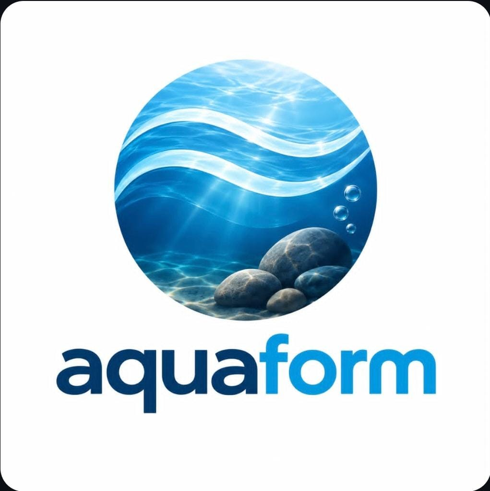

# 

# AquaSample — Registro y Trazabilidad de Muestras de Choritos (ALDEMAR SpA)

## El Problema

Las operaciones de muestreo en cultivos de mitilicultura usan planillas dispersas, fotos en teléfonos y conteos manuales que requieren retraso y coordinación de viajes. **AquaSample** reemplaza eso: una app móvil donde el operador registra fecha, ubicación, foto y conteo asistido sobre la imagen, todo sin internet. El supervisor revisa y valida en la oficina. Los reportes PDF se exportan con trazabilidad completa. El sistema sincroniza cambios cuando hay red y maneja offline como modo nativo.

## Equipo: Los Royales (N° 4)

| Rol | Integrante |
|---|---|
| Líder | Franco Ruz |
| Frontend | Antoine Rivas |
| Backend | Matías Mena |
| Tester | Leandro Ruiz |

---

## Historia de Usuario y Flujo

**Como operador de muestreo, quiero registrar una muestra en terreno (centro, tren, línea y tramo) con fotografía y conteo asistido incluso sin conexión a internet, para que al recuperar señal se sincronice automáticamente y el supervisor pueda validarla para su exportación en reportes.**

### Los 3 Roles

1. **Operador**: crea muestras en terreno (foto + conteo).
2. **Supervisor**: revisa en la oficina y emite "Validar" o "Observar".
3. **Analista**: consulta historial, dashboard y exporta reportes.


---

## Paleta de Colores

| Nombre | Código | Uso |
|---|---|---|
| Principal | `#00509E` | Barras superiores y acciones principales |
| Secundario | `#4DA6FF` | Botones secundarios y selección |
| Fondo | `#F5F5F5` | Fondo general y tarjetas |
| Texto | `#212121` | Lectura general y etiquetas |
| Validado | `#2E7D32` | Muestras aprobadas / éxito |
| Alerta | `#FF6D2D` | Observaciones y errores |

---

## Estructura del Proyecto

```
aldemar/              App Android (Kotlin, Compose, MVVM, offline-first)
backend/              API REST Spring Boot 3 (JPA, OpenAPI/Swagger)
AquaSample_DB/        Scripts SQL para inicialización
docs/diseno/          Logo, flujo UML y colores del proyecto
```

### Stack Técnico

- **Android**: Kotlin, Jetpack Compose + Material 3, MVVM, Room (BD local), WorkManager (sync en background), CameraX + Coil + Telephoto (conteo sobre foto), Retrofit (APIs), Firebase Auth.
- **Backend**: Spring Boot 3.3+, OpenAPI/Swagger, JPA, H2 (default) o MySQL.
- **Testing**: JUnit + MockK + JaCoCo >90% cobertura.
- **APIs Externas**: Open-Meteo Marine (condiciones marinas en terreno, cacheable offline).

---

## Cómo Ejecutar desde Cero

### Paso 1 — Backend Spring Boot

Requisitos: JDK 17+ y Maven.

```bash
cd backend
mvn spring-boot:run
```

**Resultado**: API en `http://localhost:8080`  
**Swagger UI**: <http://localhost:8080/swagger-ui.html>

### Paso 2 — App Android

Requisitos: Android Studio, JDK 17, SDK 35, `google-services.json` en `aldemar/app/`.

```bash
cd aldemar
./gradlew installDebug
```

**Configuración**: la URL del backend es `http://10.0.2.2:8080/api/` en emulador (o IP local en dispositivo real); se modifica en Ajustes de la app.

### Paso 3 — Pruebas y Cobertura JaCoCo

```bash
# Android: tests unitarios + reporte (cubre viewmodel/, repository/, model/, remote/, worker/)
cd aldemar
./gradlew testDebugUnitTest jacocoTestReport
# → app/build/reports/jacoco/jacocoTestReport/html/index.html

# Backend
cd backend
mvn test
# → target/site/jacoco/index.html
```

### Paso 4 — APK Release Firmada

**Una sola vez** (no subir `.jks` a git):

```bash
keytool -genkeypair -v -keystore aquasample-release.jks -alias aquasample \
        -keyalg RSA -keysize 2048 -validity 10000
```

Luego:

```bash
# Copia aldmar/keystore.properties.example → aldemar/keystore.properties
# Completa storeFile, storePassword, keyAlias, keyPassword

cd aldemar
./gradlew assembleRelease
# → app/build/outputs/apk/release/
```

**Nota**: `*.jks`, `*.keystore` y `keystore.properties` están en `.gitignore`. Sin `keystore.properties`, el build genera un APK sin firmar.

---

## Detalles Arquitectónicos

- **MVVM**: Pantallas Compose → ViewModel (StateFlow) → Repository → Room / red.
- **Offline-First**: Room es la fuente de verdad. Cambios locales quedan PENDIENTE_SINCRONIZACION. SyncSamplesWorker envía POST /api/samples y maneja 409 (conflicto) con PUT por code.
- **Sincronización**: fallos marcados como ERROR_SINCRONIZACION se reintentan; rol y claims vienen de Firebase.
- **Marinas**: Open-Meteo Marine API cacheada en DataStore para uso sin red.
